<p align="center">
  
</p>

<h1 align="center">DinoLearn 🦕</h1>

<p align="center">
  <b>Français</b> · <a href="#english">English</a>
</p>

<p align="center">
  <a href="https://pickywawa.github.io/dinolearn/"><b>▶ Jouer / Play</b></a> ·
  <a href="https://apps.apple.com/app/id6834579327"><b>App Store</b></a> ·
  <a href="https://github.com/pickywawa/dinolearn/releases/latest"><b>Android (APK)</b></a> ·
  <a href="CHANGELOG.md">Journal des versions / Changelog</a>
</p>

---

# Français

**DinoLearn** est un jeu éducatif pour les **3 à 7 ans**, entièrement guidé par la voix et l'image :
un bébé dinosaure parle, guide et encourage l'enfant. Chaque bonne réponse rapporte un fruit ; l'enfant
nourrit son dino, qui grandit et gagne des vêtements et des surprises.

**Sans publicité, sans achat intégré, sans compte, aucune donnée collectée** : tout reste sur l'appareil.
Disponible en **20 langues**.

## Jouer

| | |
|---|---|
| ▶️ **Dans le navigateur** | [pickywawa.github.io/dinolearn](https://pickywawa.github.io/dinolearn/) (téléphone ou tablette, **en paysage**) |
| 🍎 **iPhone et iPad** | [App Store](https://apps.apple.com/app/id6834579327) |
| 📱 **Android** | [APK de la dernière version](https://github.com/pickywawa/dinolearn/releases/latest) (Google Play : bientôt) |

Au premier lancement, l'appli télécharge la voix du dino et la reconnaissance vocale de la langue de
l'appareil (environ 100 à 150 Mo, Wi-Fi conseillé). Ensuite tout marche sans connexion.

## En images

<p align="center">
  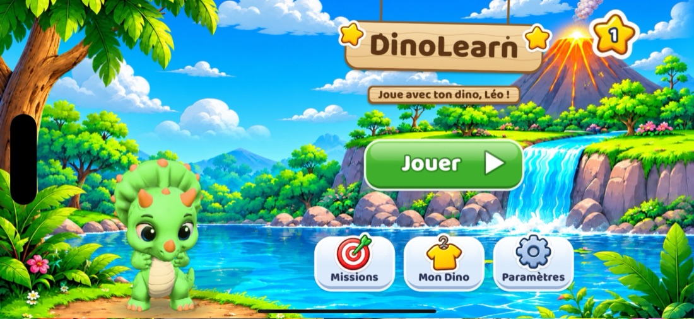
  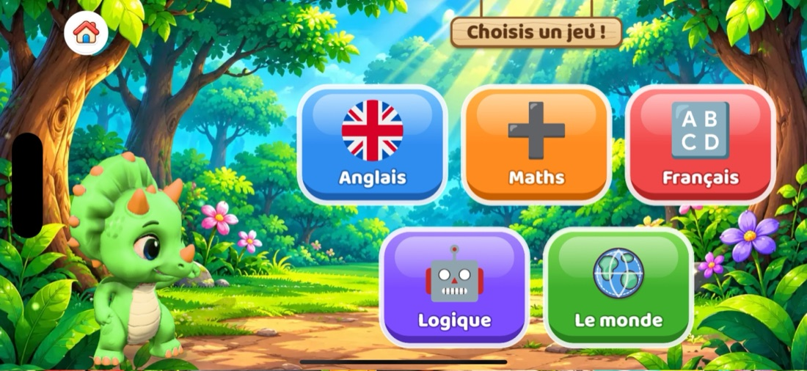
</p>
<p align="center">
  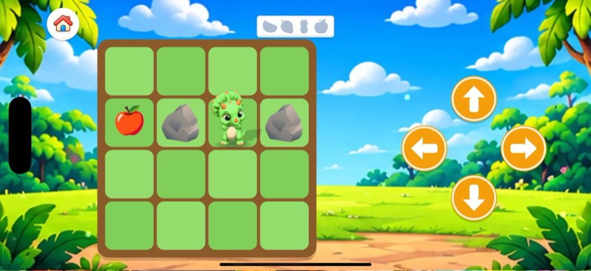
  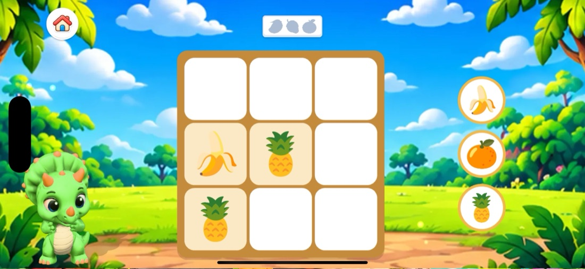
</p>
<p align="center">
  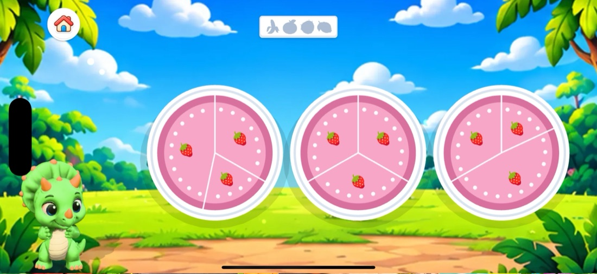
  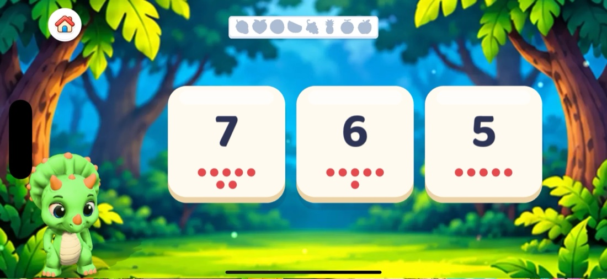
</p>
<p align="center">
  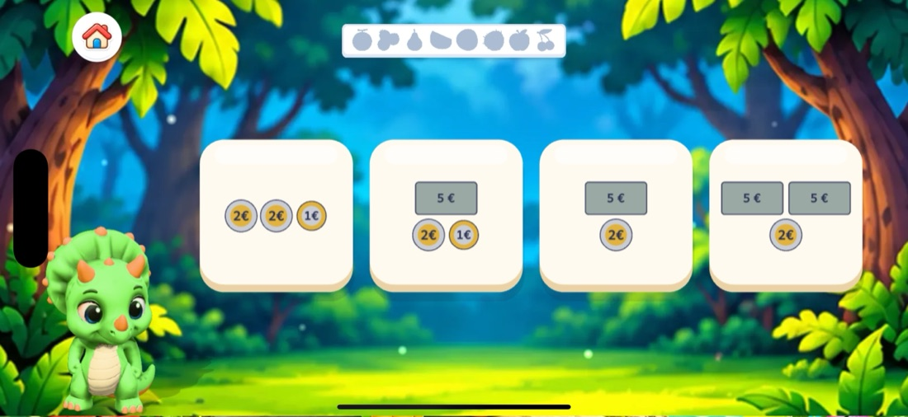
  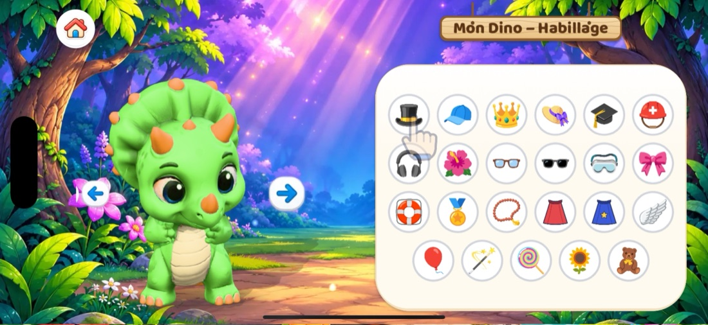
</p>

## Ce que contient le jeu

- **41 jeux, 20 niveaux chacun**, qui s'adaptent à l'âge et au niveau de l'enfant : maths (compter,
  comparer, additionner, lire l'heure, la monnaie, partager un gâteau), logique (l'intrus, les suites,
  memory, sudoku des fruits, programmer le dino avec des flèches), lecture (sons, syllabes, lettres,
  mots, histoires à écouter), anglais, découverte du monde (animaux, ombres, devinettes, son pays) et
  écriture (tracer des formes, des lettres, des chiffres au doigt).
- **Jeux à voix haute** : l'enfant répond en parlant. La reconnaissance vocale se fait **sur l'appareil**
  ([Vosk](https://alphacephei.com/vosk/)) : rien n'est enregistré ni envoyé.
- **Un dino 3D vivant** : il parle (la bouche suit les mots), cligne des yeux, danse, grandit
  (40 niveaux) et s'habille de 23 objets.
- **Espace parents**, protégé par un code : temps de jeu par jour et heure du coucher, suivi des progrès,
  choix des jeux, plusieurs enfants sur le même appareil, fiches à imprimer (en français).
- **Hors connexion** après le premier téléchargement.

Le détail de chaque jeu est dans [web/README.md](web/README.md).

## Vie privée

Aucune donnée n'est collectée ni envoyée. [Politique de confidentialité](https://pickywawa.github.io/dinolearn/confidentialite.html).
Les crédits et licences (voix, images, polices, sons, bibliothèques) sont dans l'appli : *Espace parents → Réglages*.

## Pour les développeurs

Jeu web en **Phaser 3 + TypeScript**, emballé en appli Android et iOS avec **Capacitor**.

```bash
cd web
npm install
npm run dev          # serveur local, accessible depuis le téléphone sur le même Wi-Fi
npm run icons && npm test
npm run build        # version de production dans web/dist/
```

- Code, architecture et lancement détaillé : [web/README.md](web/README.md)
- Spécifications : [docs/SPECIFICATIONS.md](docs/SPECIFICATIONS.md)
- Publication sur les stores (fiches, captures, envoi) : [web/STORES.md](web/STORES.md)
- Versions et fichiers à télécharger : [Releases](https://github.com/pickywawa/dinolearn/releases) · [CHANGELOG.md](CHANGELOG.md)

---

# English

**DinoLearn** is an educational game for children aged **3 to 7**, guided entirely by voice and pictures:
a baby dinosaur talks, guides and cheers the child on. Every right answer earns a fruit; the child feeds
the dino, which grows and wins clothes and surprises.

**No ads, no in-app purchases, no account, no data collected**: everything stays on the device.
Available in **20 languages**.

## Play

| | |
|---|---|
| ▶️ **In the browser** | [pickywawa.github.io/dinolearn](https://pickywawa.github.io/dinolearn/) (phone or tablet, **landscape**) |
| 🍎 **iPhone and iPad** | [App Store](https://apps.apple.com/app/id6834579327) |
| 📱 **Android** | [APK of the latest version](https://github.com/pickywawa/dinolearn/releases/latest) (Google Play: coming soon) |

On first launch, the app downloads the dino's voice and the speech recognition for the device language
(about 100–150 MB, Wi-Fi recommended). After that everything works offline.

## Screenshots

<p align="center">
  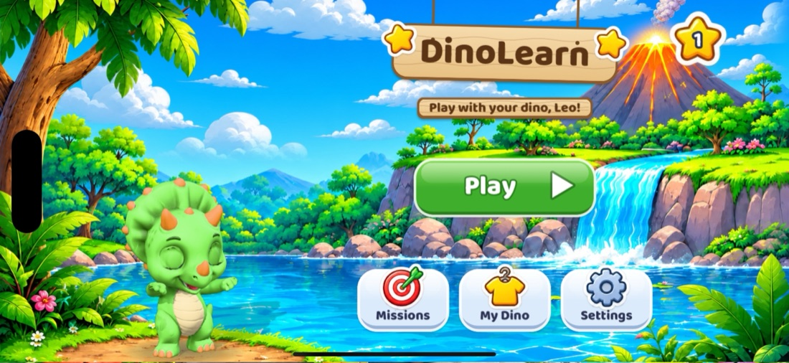
  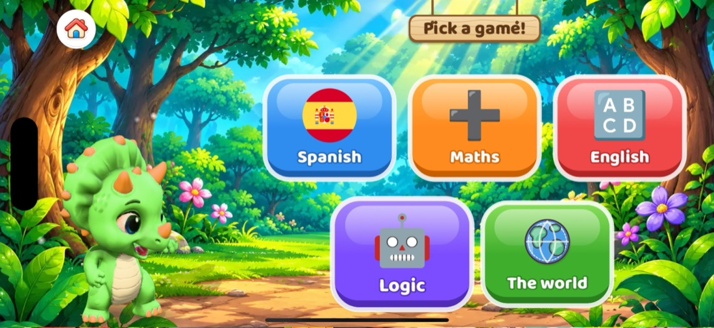
</p>
<p align="center">
  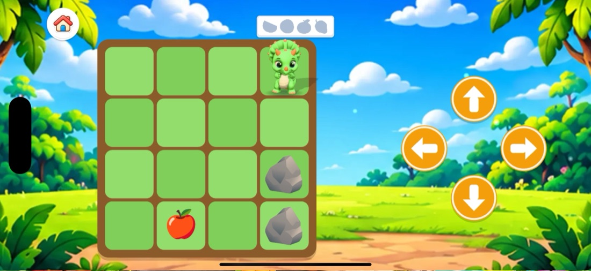
  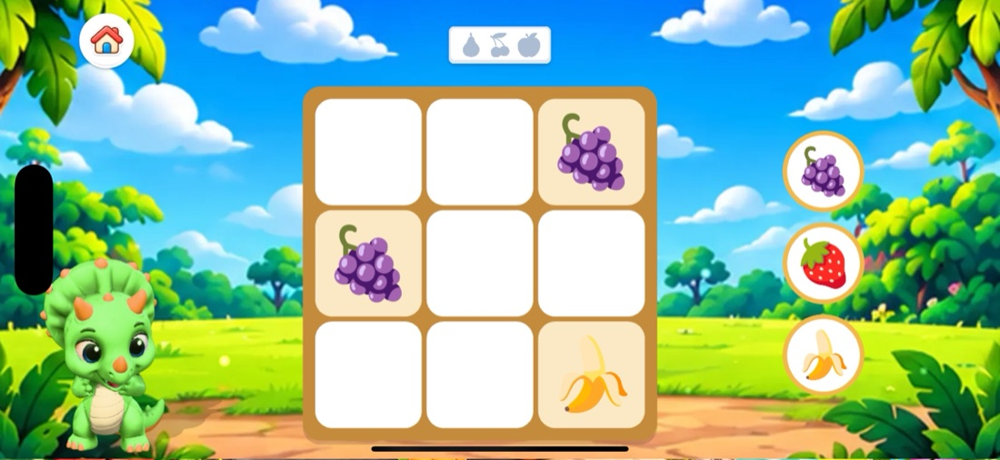
</p>
<p align="center">
  
  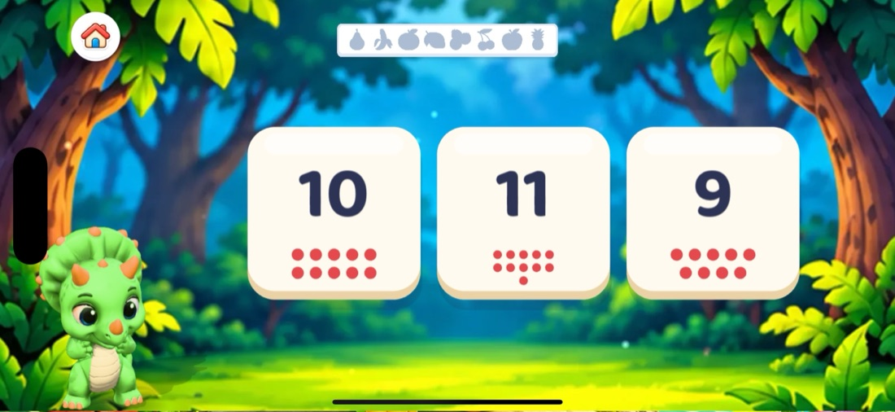
</p>
<p align="center">
  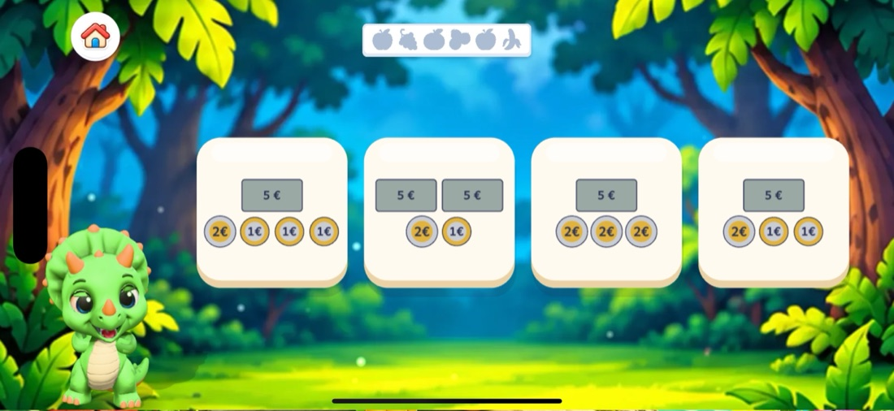
  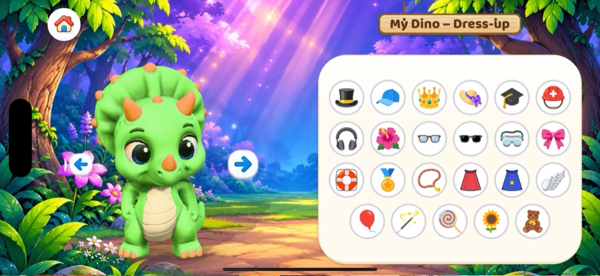
</p>

## What's inside

- **41 games, 20 levels each**, adapting to the child's age and level: maths (counting, comparing,
  adding, telling the time, money, sharing a cake), logic (odd one out, patterns, memory, fruit sudoku,
  programming the dino with arrows), reading, a second language, discovering the world (animals, shadows,
  riddles, your country) and writing (tracing shapes, letters and numbers with a finger). Reading and
  printable sheets are French only.
- **Speaking games**: the child answers out loud. Speech recognition runs **on the device**
  ([Vosk](https://alphacephei.com/vosk/)): nothing is recorded or sent.
- **A living 3D dino**: it talks (its mouth follows the words), blinks, dances, grows (40 levels) and
  wears 23 items.
- **Parents' area**, protected by a code: daily play time and bedtime, progress tracking, game
  selection, several children on one device.
- **Works offline** after the first download.

Each game is described in [web/README.md](web/README.md) (French).

## Privacy

No data is collected or sent. [Privacy policy](https://pickywawa.github.io/dinolearn/confidentialite.html).
Credits and licences (voices, images, fonts, sounds, libraries) are in the app: *Parents' area → Settings*.

## For developers

Web game built with **Phaser 3 + TypeScript**, packaged as an Android and iOS app with **Capacitor**.

```bash
cd web
npm install
npm run dev          # local server, reachable from a phone on the same Wi-Fi
npm run icons && npm test
npm run build        # production build in web/dist/
```

- Code, architecture and full setup: [web/README.md](web/README.md) (French)
- Specifications: [docs/SPECIFICATIONS.md](docs/SPECIFICATIONS.md)
- Store publishing (listings, screenshots, upload): [web/STORES.md](web/STORES.md)
- Versions and downloads: [Releases](https://github.com/pickywawa/dinolearn/releases) · [CHANGELOG.md](CHANGELOG.md)
